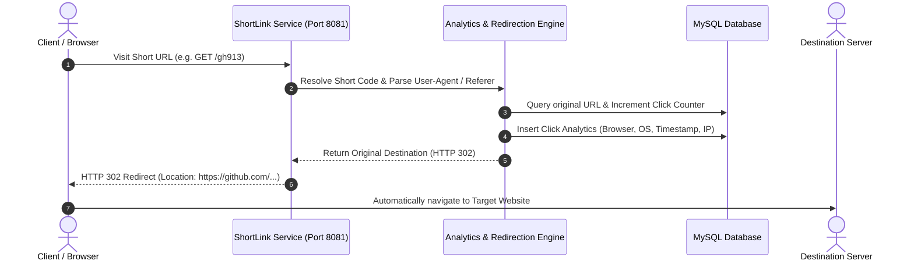
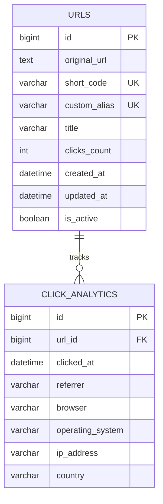

# ⚡ ShortLink — Enterprise URL Shortener Service & Analytics

<p align="center">
  
  
  
  
  
  
</p>

---

## 📌 Executive Summary

**ShortLink** is a high-performance **URL Shortener Service & Visitor Analytics Platform** designed to condense long, complex URLs into concise, collision-resistant short links. It features automated HTTP 302 redirection, real-time click tracking, device/browser fingerprinting, QR code generation, and an interactive analytics dashboard.

---

## 🌟 Key Features

| Feature | Description | Status |
|---|---|:---:|
| 🔗 **Unique Short Code Generation** | Base62 encoding with cryptographic randomness ensures collision-resistant 6-7 character hashes | ✅ Complete |
| 🏷️ **Custom Branded Aliases** | Allows users to create readable custom vanity slugs (e.g. `short.ly/my-portfolio`) | ✅ Complete |
| 🚀 **High-Speed Redirection** | Instant HTTP 302 Found redirection to original destination | ✅ Complete |
| 📊 **Real-Time Click Analytics** | Tracks total clicks, timestamp, browser, OS platform, and referrer domain | ✅ Complete |
| 📱 **Dynamic QR Code Generation** | Instant scannable QR code generator for print and mobile distribution | ✅ Complete |
| 📋 **1-Click Clipboard Copy** | Convenient URL copying with visual confirmation feedback | ✅ Complete |
| 📈 **Interactive Visual Dashboard** | SaaS-style dark mode dashboard with aggregate metrics and visit audit logs | ✅ Complete |

---

## 🏗️ System Architecture & Redirection Flow



---

## 📁 Repository Directory Structure

```tree
project 2/
├── database.sql                  # MySQL database schema (urls, click_analytics tables)
├── pom.xml                       # Maven Spring Boot specification
├── README.md                     # Comprehensive documentation & architecture
├── UrlShortenerServer.java       # Standalone executable Java REST API & Web Server (runs instantly on Java 21)
│
├── src/main/java/com/urlshortener/
│   ├── UrlShortenerApplication.java     # Spring Boot application entrypoint
│   ├── controller/
│   │   ├── UrlShortenerController.java  # REST API Controller (/api/shorten, /api/analytics)
│   │   └── RedirectController.java      # HTTP 302 redirection handler
│   ├── model/
│   │   ├── UrlMapping.java              # JPA Entity mapping for URLs
│   │   └── ClickAnalytics.java          # JPA Entity mapping for Click Audit Logs
│   ├── repository/
│   │   ├── UrlMappingRepository.java    # Spring Data JPA Repository
│   │   └── ClickAnalyticsRepository.java# Analytics JPA Repository
│   └── service/
│       └── UrlShortenerService.java     # Base62 hashing, collision check & click tracking logic
│
└── public/
    ├── index.html                # Modern Analytics Dashboard & Shortener UI
    ├── style.css                 # Sleek Dashboard theme
    └── app.js                    # Interactive analytics charts, shortening, QR code, copy link
```

---

## 🗄️ Database Schema & Relational Design



---

## 🔌 REST API Specification

| Endpoint | Method | Payload / Params | Response | Description |
|---|---|---|---|---|
| `/api/shorten` | `POST` | `{"originalUrl":"https://...", "customAlias":"my-link"}` | `200 OK` (JSON) | Generates short URL with custom alias |
| `/api/urls` | `GET` | None | `200 OK` (Array) | Retrieves all shortened links and click totals |
| `/api/analytics` | `GET` | `?code=gh913` | `200 OK` (JSON) | Detailed visitor breakdown (browsers, OS, audit log) |
| `/{shortCode}` | `GET` | Short code in path | `302 Found` | Redirects client to destination & records click |

---

## 🚀 How to Run

### 1. Instant Run in Chrome (Zero External Tools Required)
Run the self-contained server on Java 21:
```bash
cd "d:\CODEC TECHNOLOGY\project 2"
javac UrlShortenerServer.java
java UrlShortenerServer
```
Open **Google Chrome** at [http://localhost:8081](http://localhost:8081).

### 2. Spring Boot with MySQL
Import the schema:
```bash
mysql -u root -p < database.sql
```
Start Spring Boot application:
```bash
mvn spring-boot:run
```

---

## 👨‍💻 Author

**Indrasena Reddy Mittapalli**  
* GitHub: [@mittapalliindrasenareddy913-web](https://github.com/mittapalliindrasenareddy913-web)  
* Project: **Internship Task — URL Shortener Service with Analytics**  
* Organization: **CODEC TECHNOLOGY**
